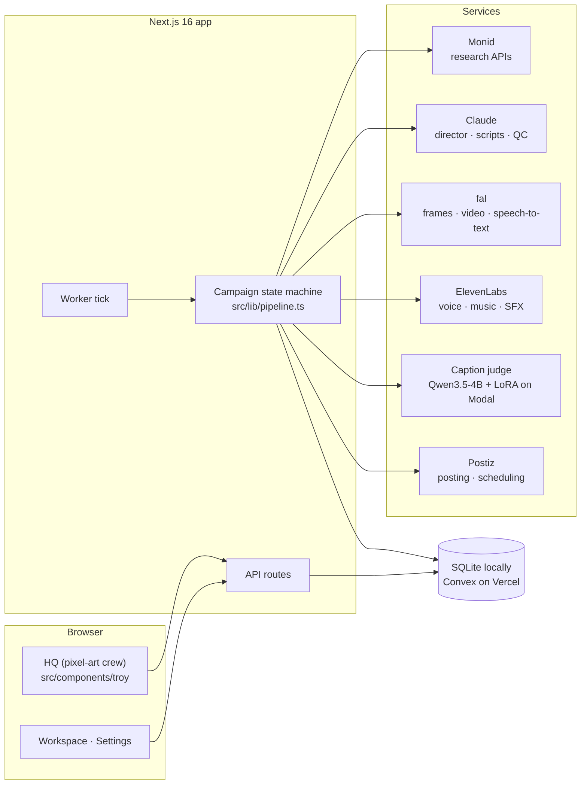

<div align="center">


# Adtopia

**An agent crew that finds what's winning on short-form video, makes the ads, and posts them to a brand's own accounts.**

[Problem](#the-problem) · [What it does](#what-it-does) · [How it works](#how-it-works) · [APIs, models and data](#apis-models-and-data) · [Run it](#run-it)

<!-- TODO before submitting: hero screenshot or GIF of the HQ replay, and the demo URL -->

</div>

## The problem

Short-form video is where small brands get found, and what works changes every week. A brand that wants to keep up needs research (which videos are beating their own audience, and why), production (a steady stream of new videos in the formats that work), and distribution (posting and scheduling across networks). That is a team's worth of work, and most small brands have none of it.

## What it does

Give Adtopia a brand's website. A crew of agents, shown as characters working in a pixel-art HQ, then:

1. **Researches** the brand, its competitors and the short-form videos in its niche that got far more views than their creators' follower counts would predict (outliers).
2. **Studies** the best outliers beat by beat: hook, timing, shots, on-screen text, delivery.
3. **Writes** a strategy and scripts that rebuild those winning mechanics for the brand's own product, without copying anyone's words, people or footage.
4. **Produces** videos, with a quality check on every shot, in three formats:
   - **Split-screen explainers** and other script-room formats: an AI presenter or voice-over, generated frames and shots, product screens captured from the brand's site, and captions.
   - **3D ads animated in code**: scripted cartoon scenes rendered with three.js in headless Chrome, with no video model.
   - **Brainrot memes**: a meme video generated shot by shot from the research's own memes, with voice, music and sound effects. These are held from posting until a person clears them.
5. **Reviews**: a person approves each video, edits its caption, or sends it back with a note.
6. **Posts and schedules** to the brand's own connected accounts through Postiz, all at once or one a day. Every post is labeled AI-generated.

The post caption is picked by a small fine-tuned model (see [the caption judge](#the-caption-judge)).

## How it works



A campaign is one record moving through six stages:

| Stage | What happens | Code |
| :--- | :--- | :--- |
| Research | The brand's own sources, then a planned sweep of TikTok, Reels and Shorts searches, ad libraries, Reddit and AI-search answers, through Monid. A scout agent reads the first results and plans follow-up searches. | `src/lib/research.ts`, `src/lib/creative/scout.ts` |
| Style | A relevance screen, then beat-by-beat breakdowns of the best outliers, with fal speech-to-text for transcripts. | `src/lib/creative/references.ts` |
| Strategy | A director (Claude) picks concepts and formats from the research; the script room writes each script and checks it against its reference. | `src/lib/strategy.ts`, `src/lib/creative/script.ts` |
| Production | First frames (Nano Banana Pro), shots (Kling 3.0 on fal), a QC pass on each, voice from ElevenLabs, then one ffmpeg cut with captions. Code ads and brainrot have their own pipelines. | `src/lib/production.ts`, `src/lib/codeads/`, `src/lib/creative/brainrot*.ts` |
| Review | Approve, edit the caption, or re-render with a note. | `src/app/api/creatives/` |
| Post | Upload the cut to Postiz and post now or schedule it on each connected channel. | `src/lib/publish.ts`, `src/lib/postiz.ts` |

**Engineering notes**

- **Long jobs on serverless.** On Vercel, a campaign takes far longer than one function call, so a worker "tick" advances it one step at a time. Every paid job is written down before it's submitted, so a retry never pays for the same render twice.
- **Cheap checks before expensive renders.** Each first frame is checked before a video model is asked to animate it.
- **A replayable demo.** `npm run demo:export` turns a finished campaign into `public/demo/<id>/script.json`. The HQ replays it on a clock, so anyone can watch a real run in two minutes without keys or spending.

### The caption judge

A pairwise judge, fine-tuned for this project. Given a search query and two TikTok captions, it answers "A" or "B" for which video did better relative to its creator's follower count.

- **Model:** [Qwen3.5-4B](https://huggingface.co/Qwen/Qwen3.5-4B) with a LoRA adapter, trained with Adaption AutoScientist. Weights: [`lollygag/hook-judge-qwen3.5-4b`](https://huggingface.co/lollygag/hook-judge-qwen3.5-4b).
- **Held-out accuracy:** 62.7% on 1,386 caption pairs from 51 niches it never saw in training, against 51.2% for Claude Haiku (+11.4 points, p < 0.0001). A simple word-count model scores 59.9%, so the judge's edge is real but modest.
- **How Adtopia uses it:** a judge trained on caption performance, used to pick the post caption. Claude writes three candidate captions. Each challenger is compared with the first in both A/B orders and replaces it only if it wins both times. The search query is the one that found the video's reference. When the judge isn't configured or doesn't answer within 20 seconds, Adtopia keeps the first caption.
- **Serving:** `modal/hook_judge.py`, on Modal (an L4 GPU, transformers and peft). It scales to zero when idle.

**Training data.** 3,711 caption pairs (7,422 rows, each pair in both A/B orders) built from 2,352 public TikTok searches across 145 niches, collected through Monid. Each pair is two videos from the same search by creators within 3x of each other's follower count, where one got at least 5x more views per follower. Paid posts are excluded, videos are 14 days to 18 months old, and the smaller creator wins exactly half the pairs. The prompt contains only the search query and the two captions: no follower or view counts. A further 1,386 pairs from 51 other niches (no shared creators or videos) are held out for testing. The dataset is not published.

## APIs, models and data

| | Used for |
| :--- | :--- |
| **Anthropic API**: Claude Sonnet 5.5, Haiku 5.5, Opus 5.5 | The director, research planner and scout, script room, QC, captions, static ads |
| **fal**: Nano Banana Pro (Gemini 3 Pro Image), Kling 3.0 Pro, Veo 3.1 Lite, Whisper | First frames, video shots, brainrot clips, speech-to-text |
| **ElevenLabs** | Voice, music, sound effects |
| **Monid** | Research: social video search, ad libraries, Reddit, AI-search answers, site data |
| **Postiz** (open source) | Posting and scheduling to the brand's own accounts |
| **Modal** | Serving the caption judge |
| **Hugging Face**: Qwen3.5-4B base, our LoRA adapter | The caption judge |
| **Adaption AutoScientist** | Fine-tuning the caption judge |
| **Dataset** | 3,711 training and 1,386 test TikTok caption pairs, built by us from public search results (see above; not published) |

**Open-source libraries:** Next.js, React, Tailwind CSS, Convex, better-sqlite3, three.js, ffmpeg, Remotion, Vitest, transformers and peft. Fonts: Fredoka (SIL OFL 1.1) and Luckiest Guy (Apache 2.0).

## Run it

**Prerequisites:** Node.js 20.9 or later, ffmpeg on your `PATH`, and Google Chrome (for product screens and code ads).

### Watch the demo (no keys, no cost)

```bash
npm install
npm run dev
```

Open [http://localhost:3000/demo](http://localhost:3000/demo). The arrow keys walk the tour, R restarts it, and `?autoplay=1` plays it straight through.

### Run a real campaign

A real campaign spends money on the services above, so set a budget before you start.

```bash
cp .env.example .env.local   # or paste the keys in Settings
npm run dev
```

| Variable | Needed for |
| :--- | :--- |
| `ANTHROPIC_API_KEY` | Strategy, scripts, QC, captions |
| `FAL_KEY` | Frames, video, speech-to-text |
| `ELEVENLABS_API_KEY` | Voice, music, sound effects |
| `MONID_API_KEY` | Research |
| `POSTIZ_API_KEY` | Posting and scheduling (connect the brand's channels in Postiz) |
| `HOOK_JUDGE_URL`, `HOOK_JUDGE_KEY`, `HOOK_JUDGE_SECRET` | The caption judge (optional; deploy it with `modal deploy modal/hook_judge.py`) |

Deploying to Vercel with Convex is covered in [`docs/convex.md`](docs/convex.md).

### Tests

```bash
npm test            # offline: in-memory SQLite, fake providers
npm run typecheck
```

Tests that call paid services run only when their opt-in variable is set.

## Rules Adtopia keeps

- **Brand-owned accounts only.** It posts only to channels the brand connected itself, and never invents accounts or people.
- **Labeled.** Every post is marked AI-generated: TikTok's own AI label, and `#AIgenerated` on other networks.
- **No fake testimonials.** Scripts never claim results or experiences that didn't happen, and claims stay within what the brand's own site says.
- **Held until cleared.** Brainrot memes and one-to-one remakes don't post until a named person clears them.
- **A person approves.** Nothing posts until someone approves it.
- **Budgets come from people.** The autopilot never starts a campaign without a budget someone set.

## Status and limits

Adtopia is a hackathon prototype.

- The demo replays recorded campaigns; post analytics in the replay are illustrative.
- Postiz handles posting and scheduling. Post analytics aren't pulled back yet.
- On Vercel with Convex, static ads and generated product screens don't run, because they need local Chrome and ffmpeg.
- The 3D code-ad engine is under the PolyForm Noncommercial license (`src/lib/codeads/engine/LICENSE.md`), so this build is for non-commercial use.

## Team

<!-- TODO: names and roles -->
